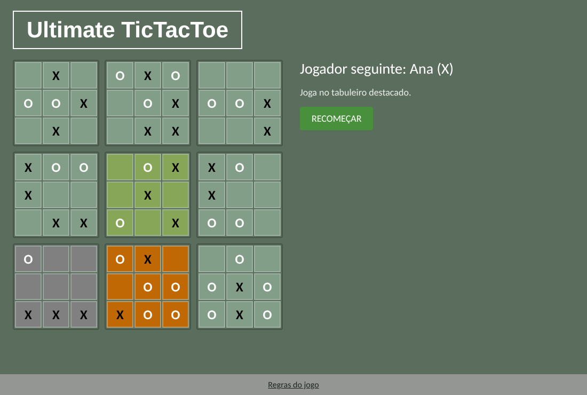
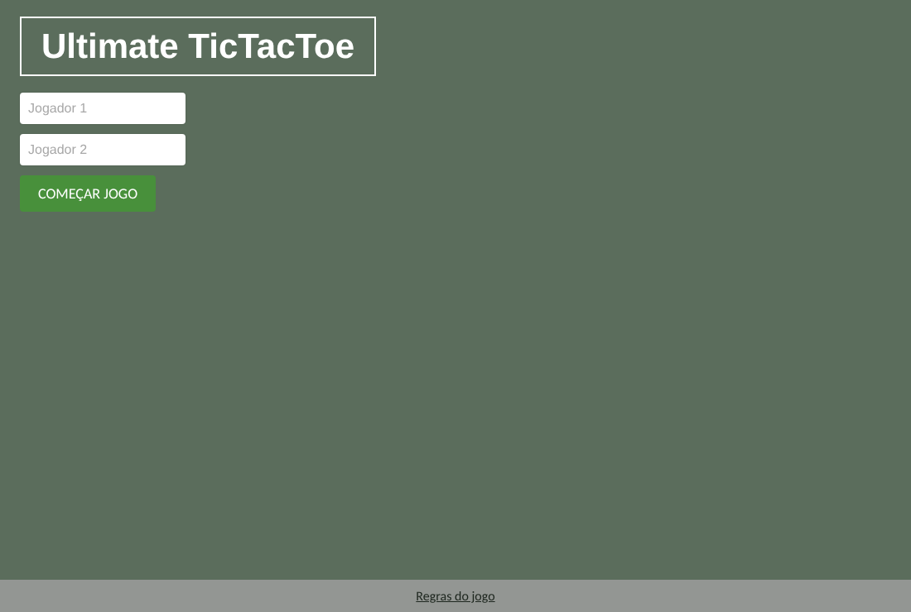
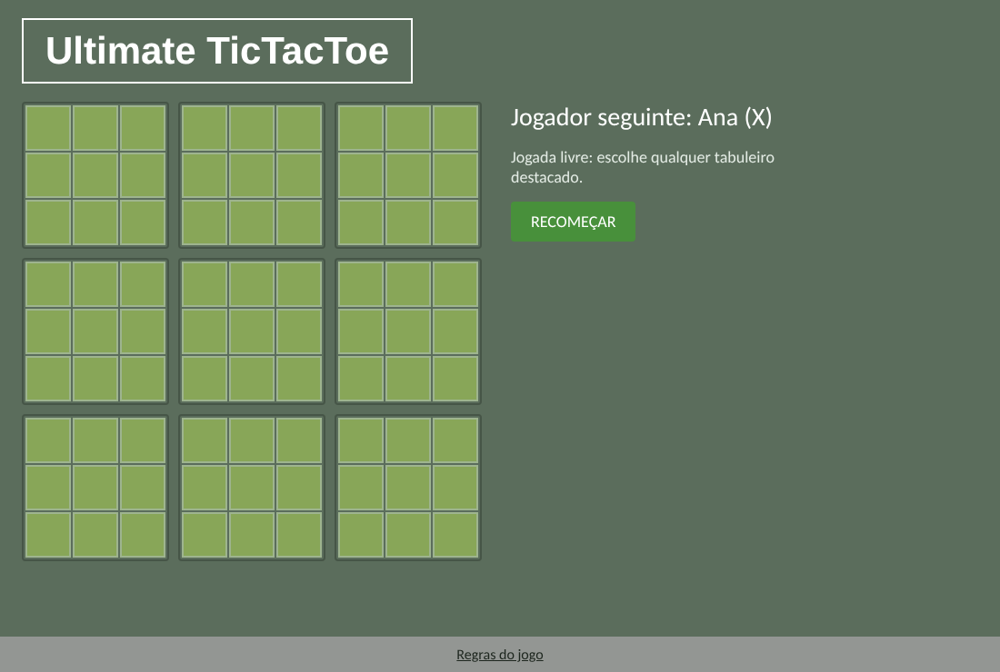
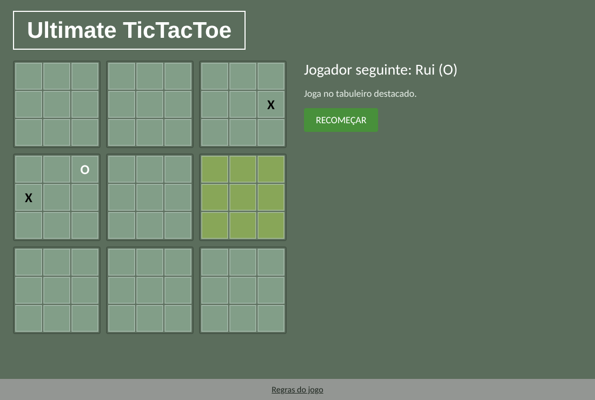
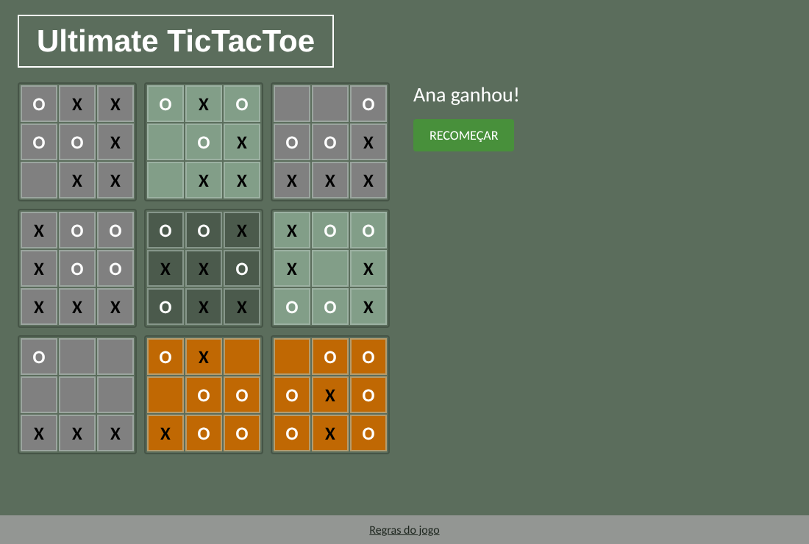

# Ultimate TicTacToe

Uma versão do **Jogo do Galo Supremo** (*Ultimate Tic-Tac-Toe*) para dois jogadores, feita em React. Em vez de um único tabuleiro, jogam-se **9 jogos do galo ao mesmo tempo**, e cada jogada decide onde o adversário tem de jogar a seguir.

<p align="center">
  
</p>

## Índice

- [Como funciona o jogo](#como-funciona-o-jogo)
- [Regras](#regras)
- [Como jogar](#como-jogar)
- [Screenshots](#screenshots)
- [Tecnologias](#tecnologias)
- [Instalação e execução](#instalação-e-execução)
- [Estrutura do projeto](#estrutura-do-projeto)
- [Como o código está organizado](#como-o-código-está-organizado)
- [Possíveis melhorias](#possíveis-melhorias)

## Como funciona o jogo

O tabuleiro é uma grelha 3×3 de **tabuleiros pequenos**, e cada tabuleiro pequeno é, ele próprio, um jogo do galo 3×3. São 81 casas no total.

A regra que torna o jogo interessante: **a casa onde jogas decide em que tabuleiro pequeno o teu adversário tem de jogar.** Se jogares na casa do canto superior direito de um tabuleiro, o adversário é obrigado a jogar no tabuleiro do canto superior direito da grelha grande.

Isto obriga a pensar duas jogadas à frente: uma boa jogada no teu tabuleiro pode entregar ao adversário o tabuleiro de que ele precisa.

## Regras

1. O **Jogador 1 joga com X** e o **Jogador 2 com O**. No início de cada jogo é sorteado quem começa.
2. Na primeira jogada, quem começa pode jogar em **qualquer casa de qualquer tabuleiro**.
3. A partir daí, a posição da casa jogada indica o tabuleiro do adversário. Por exemplo, jogar na casa central de um tabuleiro obriga o adversário a jogar no tabuleiro central.
4. **Ganhar um tabuleiro pequeno**: quem fizer 3 em linha (horizontal, vertical ou diagonal) num tabuleiro pequeno ganha-o, e o tabuleiro fica marcado com a cor do vencedor. Já não se pode jogar nele.
5. **Tabuleiro empatado**: se um tabuleiro pequeno ficar cheio sem vencedor, fica empatado. Não conta para nenhum jogador e já não se pode jogar nele.
6. **Jogada livre**: se a casa jogada apontar para um tabuleiro que já está ganho ou empatado, o adversário pode jogar em **qualquer tabuleiro que ainda esteja em jogo**.
7. **Vitória**: ganha o primeiro jogador que conquistar **3 tabuleiros pequenos em linha** na grelha grande.
8. **Empate**: se todos os tabuleiros ficarem terminados e ninguém fizer linha, o jogo termina empatado.

> Não conheces o jogo? Há um vídeo com as regras explicadas no link **"Regras do jogo"** no rodapé da aplicação.

## Como jogar

1. Abre o jogo. No ecrã inicial podes escrever o nome dos dois jogadores. Se deixares em branco, ficam "Jogador 1" e "Jogador 2".
2. Carrega em **Começar jogo** (ou prime Enter num dos campos de nome).
3. Os tabuleiros onde podes jogar aparecem **destacados a verde**. O painel à direita mostra de quem é a vez e uma dica sobre onde jogar.
4. Clica numa casa livre de um tabuleiro destacado para jogares. Cliques em casas ocupadas ou em tabuleiros não destacados são ignorados.
5. O jogo termina quando alguém ganha ou há empate. Carrega em **Recomeçar** para voltar ao ecrã inicial e jogar de novo.

**Legenda de cores**

| Cor | Significado |
| --- | --- |
| Verde-claro vivo | Tabuleiro onde podes jogar agora |
| Cinzento | Tabuleiro ganho pelo **X** |
| Laranja | Tabuleiro ganho pelo **O** |
| Cinzento-escuro | Tabuleiro empatado |

## Screenshots

| Ecrã inicial | Novo jogo (jogada livre) |
| :---: | :---: |
|  |  |

| Primeiras jogadas | Final com vitória |
| :---: | :---: |
|  |  |


## Tecnologias

| Área | Tecnologia |
| --- | --- |
| Linguagens | JavaScript (ES6+), JSX, CSS3, HTML5 |
| Interface | [React](https://react.dev/) 18 (componentes de classe e de função) |
| Ferramentas de build | [Create React App](https://create-react-app.dev/) (`react-scripts` 5), webpack, Babel |
| Testes | [Jest](https://jestjs.io/), executado através do `react-scripts` |
| Qualidade de código | ESLint com a configuração `react-app` |
| Gestor de pacotes | npm |

Não há backend, base de dados nem bibliotecas externas de interface: o jogo corre inteiramente no browser, e o estilo é CSS puro (flexbox e variáveis CSS).

## Instalação e execução

**Requisitos:** [Node.js](https://nodejs.org/) 18 ou superior (inclui o npm) e [Git](https://git-scm.com/).

```bash
# 1. Clonar o repositório
git clone https://github.com/davdoliveira/Ultimate-TicTacToe.git
cd Ultimate-TicTacToe

# 2. Instalar as dependências
npm install

# 3. Iniciar em modo de desenvolvimento
npm start
```

A aplicação abre em <http://localhost:3000>.

### Outros comandos

| Comando | O que faz |
| --- | --- |
| `npm start` | Servidor de desenvolvimento com recarregamento automático |
| `npm test` | Corre os testes em modo interativo |
| `npm run build` | Gera a versão otimizada para produção na pasta `build/` |

> **Nota sobre o TypeScript:** o `react-scripts` 5 só é compatível com TypeScript 3 ou 4. Por isso o `package.json` fixa `typescript@^4.9.5` nas `devDependencies`. Sem isto, o `npm install` instala a versão mais recente e o `npm run build` falha com um erro do ESLint.

## Testes

As regras do jogo estão isoladas em funções puras (`src/gameLogic.js`) e cobertas por **15 testes unitários** (`src/gameLogic.test.js`):

- deteção das 8 linhas vencedoras e de tabuleiros empatados
- a casa jogada decide o tabuleiro do adversário
- jogadas inválidas são rejeitadas (casa ocupada, tabuleiro errado, jogo terminado)
- alternância entre X e O
- jogada livre quando o tabuleiro de destino já está ganho ou empatado
- vitória global com 3 tabuleiros em linha
- empate global quando todos os tabuleiros terminam sem linha
- o estado anterior nunca é alterado (imutabilidade)

```bash
CI=true npm test -- --watchAll=false
```

Além disso, o jogo foi testado ponta a ponta num browser (Chromium, com Playwright): foram jogadas 24 partidas completas com jogadas aleatórias, e a cada jogada o ecrã foi comparado com um modelo independente das regras.

## Estrutura do projeto

```
.
├── docs/
│   └── screenshots/        # Imagens usadas neste README
├── public/
│   ├── index.html          # Página HTML base
│   ├── manifest.json       # Metadados da aplicação (PWA)
│   ├── favicon.ico
│   ├── logo192.png
│   └── logo512.png
├── src/
│   ├── index.js            # Ponto de entrada (createRoot)
│   ├── App.js              # Componente raiz: Header + Game + Footer
│   ├── Game.js             # Estado do jogo, ecrã inicial e painel de informação
│   ├── Board.js            # Um tabuleiro pequeno (3x3)
│   ├── Square.js           # Uma casa
│   ├── Header.js           # Título
│   ├── Footer.js           # Rodapé com a ligação às regras
│   ├── gameLogic.js        # Regras do jogo (funções puras)
│   ├── gameLogic.test.js   # Testes unitários das regras
│   └── App.css             # Estilos
├── package.json
└── package-lock.json
```

## Como o código está organizado

- **Separação entre regras e interface.** `gameLogic.js` não depende do React: recebe o estado e devolve o novo estado (`playMove`, `isBoardActive`, `getBoardResult`, `calculateWinner`). Isto torna as regras fáceis de testar e de reutilizar.
- **Estado imutável.** Cada jogada cria cópias dos arrays em vez de os alterar, o que evita bugs e facilita a atualização do React.
- **Componentes pequenos.** `Game` guarda o estado e distribui-o por `Board` e `Square`, que só desenham o que recebem.
- **Resultado dos tabuleiros.** Cada tabuleiro pequeno tem um resultado: `'X'`, `'O'`, `'D'` (empate) ou `null` (ainda em jogo). O CSS usa esse valor para escolher a cor.
- **Layout adaptável.** O tamanho das casas é calculado com `clamp()` e variáveis CSS, por isso o jogo cabe em ecrãs de computador e de telemóvel.


## Possíveis melhorias

- Modo contra o computador (por exemplo, com minimax)
- Jogo online entre dois jogadores
- Botão de desfazer e histórico de jogadas
- Pontuação acumulada entre partidas
- Animações e sons
- Tema escuro e traduções para outros idiomas
